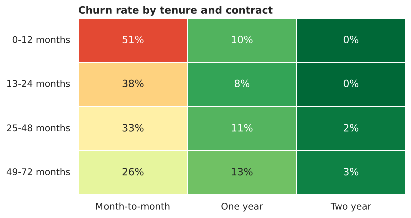
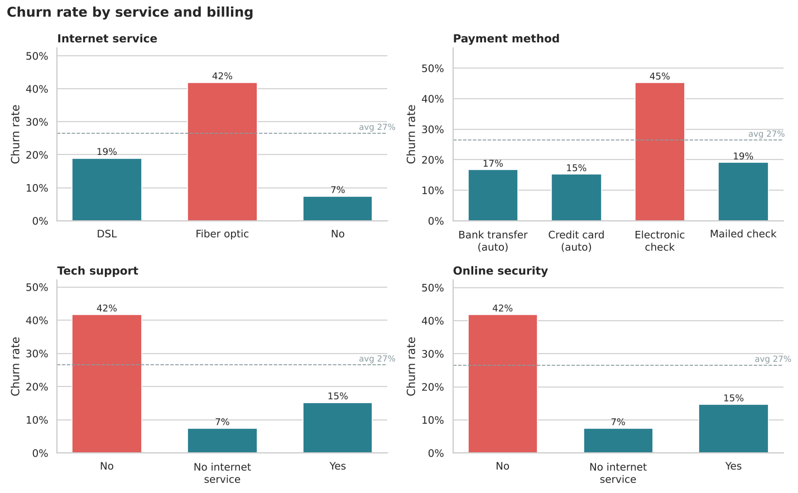

# Customer Churn Analysis | Python (Pandas, NumPy, Matplotlib, Seaborn)

Exploratory data analysis of **7,043 telecom customers** to find out who leaves, why, and what it costs, ending with concrete retention recommendations.



---

## Business questions

1. What share of customers churn, and how much monthly revenue does that cost?
2. Which groups churn the most by contract, tenure, services, billing and profile?
3. Where should a retention budget be focused?

## Dataset

**IBM Telco Customer Churn** (sample data published by IBM): 7,043 customers and 21 columns. They cover demographics, account details (tenure, contract, billing, charges), subscribed services, and `Churn` (left in the last month: Yes/No).

## Tools

Python 3 · Pandas · NumPy · Matplotlib · Seaborn · Jupyter Notebook

## Project structure

```
Customer_Churn_Analysis/
├── data/
│   └── Telco-Customer-Churn.csv
├── notebooks/
│   └── customer_churn_analysis.ipynb    full analysis, already run with outputs
├── images/                              charts saved by the notebook
│   ├── 01_churn_overview.png
│   ├── 02_churn_by_contract.png
│   ├── 03_churn_by_tenure.png
│   ├── 04_tenure_distribution.png
│   ├── 05_monthly_charges.png
│   ├── 06_services_and_billing.png
│   ├── 07_tenure_contract_heatmap.png
│   └── 08_correlation.png
├── requirements.txt
└── README.md
```

## How to run

```bash
pip install -r requirements.txt
cd notebooks
jupyter notebook customer_churn_analysis.ipynb
```

Run all cells (Kernel > Restart & Run All). The charts are saved to `images/`. You can also open the notebook on GitHub, or upload it to Google Colab along with the CSV.

## Data cleaning

- **No duplicate customers** and no null values on load.
- `TotalCharges` was stored as text because **11 cells were blank spaces**. All 11 belong to customers with **tenure = 0** (signed up this month, not billed yet), so I set them to **0** instead of dropping them, then converted the column to numeric.
- Checked consistency: `TotalCharges ≈ tenure × MonthlyCharges` (median ratio 1.00).
- Recoded `SeniorCitizen` from 0/1 to No/Yes. Added a numeric churn flag and tenure groups (0–12, 13–24, 25–48, 49–72 months).

## Key findings

| # | Finding | Evidence |
|---|---|---|
| 1 | **26.5% of customers churned**, costing **$139K of monthly revenue** (30.5%) | 1,869 of 7,043 customers |
| 2 | **Contract type is the biggest driver** | Month-to-month **42.7%** vs one-year 11.3% vs two-year **2.8%**. 88.6% of churners are month-to-month |
| 3 | **The first year is the danger zone** | **47.4%** churn at 0–12 months vs 9.5% after 4 years. Median churner leaves at 10 months (loyal customers: 38) |
| 4 | **New + month-to-month = highest risk** | These customers are 28% of the base but churn at **51.4%**, which is **54.8% of all churn** |
| 5 | **Fibre-optic customers churn heavily** | **41.9%** vs 19.0% for DSL. Churners pay more (median $79.65 vs $64.43 a month) |
| 6 | **Electronic-check payers churn about 3x more** | **45.3%** vs 15–17% for automatic card or bank payments |
| 7 | **Support add-ons protect retention** | No tech support: 41.6% churn vs 15.2% with it (online security shows the same pattern) |
| 8 | **Profile risk factors** | Senior citizens 41.7%, no partner 33.0%, no dependents 31.3% |



## Recommendations

1. **Move month-to-month customers onto annual plans**: offer a discount or bonus service for switching in the first 3 months.
2. **First-year onboarding programme**: proactive check-ins at months 1, 3 and 6, since more than half of all churn comes from new month-to-month customers.
3. **Bundle tech support and online security** free for 6 months on fibre plans.
4. **Autopay incentive**: a small monthly credit for moving off electronic checks.
5. **Investigate fibre-optic satisfaction** (price, speed, outages). It is the highest-revenue product and also the highest-churn one.

## Next steps

- Build a churn-prediction model (logistic regression or random forest) to score at-risk customers each month.
- Estimate the revenue saved if first-year churn among month-to-month customers fell by 10 percentage points.

## Skills demonstrated

Data cleaning · exploratory data analysis · segmentation and cohort comparison · data visualisation · turning findings into business recommendations

---
**Author:** Ashik Dev A S · [LinkedIn](https://www.linkedin.com/in/ashik-dev-301b63252)
